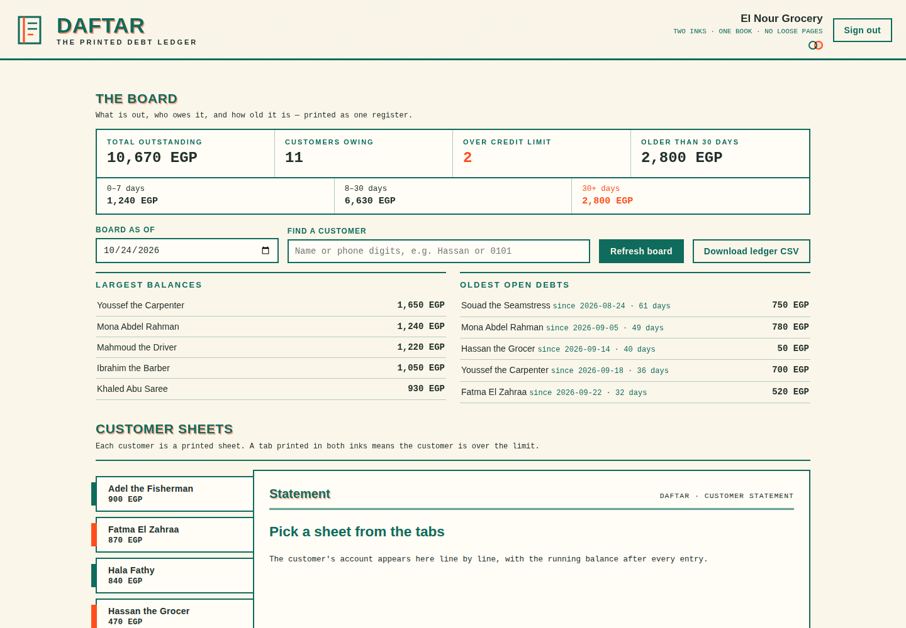

# Daftar

A paper debt notebook gets wet, torn, lost, or left at home. Daftar keeps the same simple habit on a phone or a shop computer: write what the customer took, write what he paid, and let the balance take care of itself.

This is kasf hesab without accounting theatre. One shop, its customers, and a ledger that can be read standing at the counter.

## What it does

- Customer pages with phone, address, a private shop note, and a credit limit for each person.
- Debt and payment entries in date order. The running balance is calculated after every line.
- A debt can pass the credit limit when the owner decides to allow it. The entry is recorded and marked, not hidden.
- A payment larger than the current balance is refused. The daftar does not invent change.
- A home board with total money outside, the largest balances, customers over their limit, and open debt by age.
- Old debt is aged in three buckets: 0 to 7 days, 8 to 30 days, and over 30 days. Payments settle the oldest open debt first.
- A printable customer statement.
- A polite English WhatsApp reminder written for each customer. Daftar prepares the text only and never sends it.
- Customer search by name or part of a phone number.
- CSV customer import with duplicate phone detection and a skipped rows report.
- CSV export of the whole ledger.

## Run the local demo

```bash
cd backend
python3 seed.py
python3 app.py
```

Open `http://127.0.0.1:8091`.

Demo login:

```text
username: shopkeeper
password: notebook123
```

The seed is a fictional grocery shop with 12 customers and 32 entries. It includes two customers over their limits, one account settled to zero, and one debt dated 24 August 2026. Do not treat the demo password as a real credential.

## Shape of the code

```text
backend/
  app.py       REST API, login, import, export, board
  ledger.py    balance, statement, and aging math
  seed.py      fictional shop and dated sample ledger
frontend/
  index.html   English LTR risograph ledger interface (see DESIGN.md)
tests/
  test_daftar.py
```

One SQLite database sits behind the API. The browser is only a view, so the same daftar can be opened from a computer, Android, or iOS browser when the backend is hosted. No public deployment is included here.

## Import format

Customer imports need at least these columns:

```csv
name,phone,address,note,credit_limit
Ahmed Ali,01000000000,Market Street,,1000
```

A phone already attached to another customer is skipped and named in the response. A phone repeated inside the same file is also skipped after its first row.

## Words used in the code

`daftar` is the notebook. `kasf hesab` is the customer statement. An entry is either `debt` for goods taken or `payment` for money handed back. `flagged` means the debt was allowed after it pushed the customer beyond his agreed limit.

## Known limits

- There is one seeded owner account and no self service shop registration.
- Entries cannot be edited or deleted through the interface. A wrong entry needs a correcting entry for now. This keeps the history visible, but a proper reversal flow still belongs on the work list.
- Login tokens live in server memory and disappear when the process restarts.
- Password storage is hashed properly, but the app still needs HTTPS and login rate limiting before it belongs on the public internet.
- Amounts use rounded decimal values stored as SQLite reals. A shop handling formal accounting should move money to integer piasters before production.
- The aging view assumes payments settle the oldest debt first. A shop that assigns a payment to a specific purchase will need entry level allocation.

## Screenshots



The board of the seeded demo shop: EGP 10,670 still outside, debts aged
in bands, every customer a printed sheet. One customer's page, with her
running-balance statement, is in
[docs/screenshot-customer.png](docs/screenshot-customer.png). All data
on these screens is fictional demo data.
